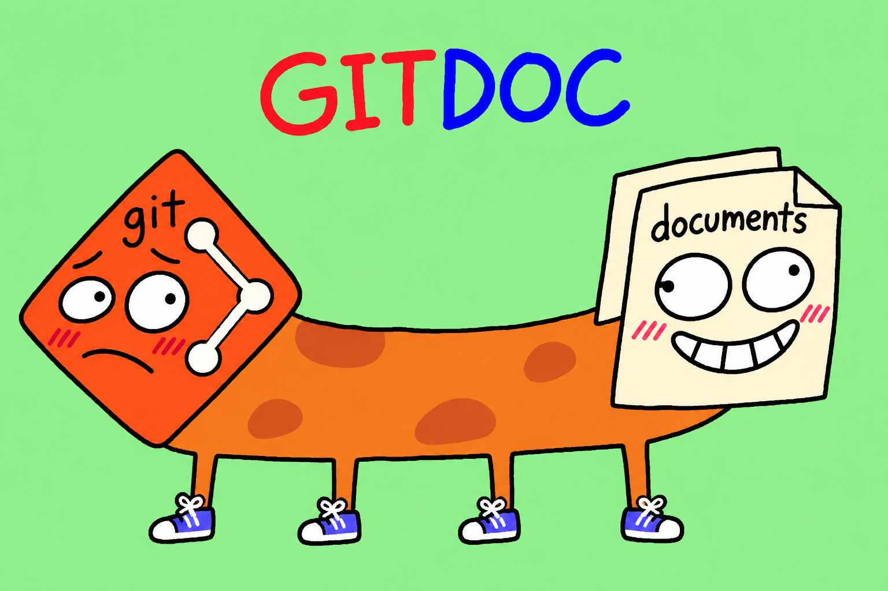

# GitDoc · 로컬 문서 버전 관리

[English](README.md) · 한국어



한글, Word, PDF, PowerPoint, Excel을 GitDoc에서 열고, 지원하는 항목을 직접 편집하고, 버전을 관리합니다. 두 문서를 나란히 열어 변경 위치를 확인하고, 수정안을 검토하거나 별도 브랜치에서 병합할 수 있습니다. [기획서와 화면 시안](기획서.md)

## GitDoc Hub

[GitDoc Hub](hub/README.md)는 텍스트 문서 공동 편집, 저장소 초대, 버전 관리, 검토, MCP를 제공하는 웹 작업 공간입니다.

## 시작

GitDoc은 Rust의 [eframe](https://github.com/emilk/egui/tree/main/crates/eframe)으로 macOS와 Windows에서 네이티브 창을 엽니다. Python 문서 엔진을 자식 프로세스로 시작해 표준 입출력으로 연결합니다. 데스크톱 앱과 MCP가 이 엔진과 SQLite 저장소를 공유합니다.

### 다운로드

[Releases 페이지](../../releases)의 각 릴리스에 실험용 패키지가 첨부됩니다. Python 엔진과 PDFium이 들어 있어 Python이나 Rust를 설치하지 않아도 됩니다.

| 시스템 | 파일 |
| --- | --- |
| macOS 13 이상, Apple Silicon | `GitDoc-<버전>-macos-arm64.dmg` |
| Windows 10 이상, x64 | `GitDoc-<버전>-windows-x64-setup.exe` |

macOS 패키지는 Apple Silicon용입니다.

- **macOS**에서 디스크 이미지를 열고 GitDoc을 응용 프로그램 폴더로 끌어 놓은 뒤 실행합니다. v0.1.2부터 공개 앱과 디스크 이미지는 Developer ID로 서명되며, 디스크 이미지에 Apple 공증 티켓이 포함됩니다.
- **Windows**에서 설치 파일을 실행합니다. 설치 파일에는 서명이 없습니다. SmartScreen 화면이 나타나면 **추가 정보 ▸ 실행**을 선택합니다. 관리자 권한 없이 현재 사용자에게 설치하고 `gitdoc://` 링크를 등록합니다. 제거하면 앱과 링크 등록이 함께 지워집니다.

패키지 앱은 저장소, 미리보기 캐시, 로그를 macOS에서는 `~/Library/Application Support/GitDoc`, Windows에서는 `%APPDATA%\GitDoc`에 둡니다. 앱을 제거하거나 교체해도 이 폴더는 남습니다. `DOCVERS_DB`로 다른 저장소 파일을 지정할 수 있습니다.

LibreOffice, Poppler, rhwp, Tesseract는 포함하지 않습니다. 필요한 도구는 [버전 관리와 비교](#버전-관리와-비교)의 안내대로 설치합니다. 패키지 앱은 데이터 폴더의 `tools/rhwp/rhwp`(Windows는 `rhwp.exe`)에서도 rhwp를 찾습니다.

포함된 Python으로 같은 저장소에 CLI와 MCP 서버를 실행할 수 있습니다. macOS에서는 `/Applications/GitDoc.app/Contents/Resources/python/bin/python3`로 `/Applications/GitDoc.app/Contents/Resources/app/docvers.py` 또는 `mcp_server.py`를 실행합니다. Windows에서는 `%LOCALAPPDATA%\Programs\GitDoc`의 `python\python.exe`와 `app\docvers.py` 또는 `app\mcp_server.py`를 사용합니다.

### 소스에서 실행

Python 3.12와 최신 안정 Rust/Cargo가 필요합니다. macOS는 12 이상 및 Xcode Command Line Tools, Windows는 MSVC Rust 도구 체인 및 Visual Studio Build Tools의 C++ 데스크톱 개발 도구가 필요합니다.

**macOS**

```sh
python3.12 -m venv .venv
.venv/bin/python -m pip install -r requirements.txt -r requirements-mcp.txt -r requirements-desktop.txt
.venv/bin/python docvers.py open
```

**Windows PowerShell**

```powershell
py -3.12 -m venv .venv
.\.venv\Scripts\python.exe -m pip install -r requirements.txt -r requirements-mcp.txt -r requirements-desktop.txt
.\.venv\Scripts\python.exe docvers.py open
```

`docvers.py open`은 실행 파일이 없으면 Cargo로 빌드합니다. 소스를 갱신한 후에는 `cargo build --locked --manifest-path desktop/native/Cargo.toml`로 다시 빌드합니다. macOS에서 Finder로 실행하려면 `./desktop/build.sh`로 `.build/GitDoc.app`을 빌드합니다.

기본 저장소는 `data/documents.sqlite3`입니다. `DOCVERS_DB`로 경로를 바꾸고 데스크톱 앱, CLI, MCP에 같은 값을 지정합니다.

### 릴리스 만들기

[릴리스 워크플로](.github/workflows/release.yml)는 `packaging/macos.sh`와 `packaging/windows.ps1`로 두 패키지를 빌드하고, 깨끗한 러너에 각각 설치한 뒤 `packaging/smoke.py`로 확인합니다. 앱이나 패키징을 바꾸는 풀 리퀘스트, 수동 실행, 버전 태그에서 실행됩니다.

1. `desktop/native/Cargo.toml`의 `version`을 새 버전으로 바꾸고 `cargo update --manifest-path desktop/native/Cargo.toml --package gitdoc-desktop`으로 `Cargo.lock`을 갱신한 뒤 병합합니다. 패키지 버전은 이 파일에서 가져옵니다.
2. 그 커밋에 `vX.Y.Z` 태그를 붙여 푸시합니다. `git tag v0.2.0 && git push origin v0.2.0`
3. 워크플로가 태그와 버전이 일치하는지 확인합니다. 양쪽 설치 테스트와 macOS Developer ID 서명, Apple 공증, 공증 티켓 첨부, Gatekeeper 검사를 통과하면 태그 실행에서 두 설치 파일을 내려받아 저장소 소유자 계정으로 함께 게시합니다.

macOS 서명 및 공증 단계는 원본 저장소의 버전 태그 푸시에서 실행됩니다. 이 단계에서 Actions Secret `MACOS_CERTIFICATE_P12_BASE64`, `MACOS_CERTIFICATE_PASSWORD`, `APPLE_ID`, `APPLE_TEAM_ID`, `APPLE_APP_SPECIFIC_PASSWORD`를 사용합니다. 풀 리퀘스트와 수동 실행 빌드는 ad-hoc 서명을 사용합니다.

로컬에서는 Apple Silicon Mac에서 `sh packaging/macos.sh`, Inno Setup 6을 설치한 PowerShell 7에서 `./packaging/windows.ps1`을 실행합니다. 결과물은 `dist/`에 생깁니다. 로컬 macOS 번들은 ad-hoc 서명됩니다.

## 브라우저 뷰어

데스크톱 앱에서 **브라우저에서 보기**를 누르면 현재 버전 또는 두 버전 비교가 기본 브라우저에서 열립니다. 보고 있던 페이지나 시트의 선택 셀도 이어서 볼 수 있습니다.

`python docvers.py open --browser`로 로컬 문서함을 열 수 있습니다. Codex 내장 브라우저에서 확인하려면 데스크톱 앱의 **웹 링크 복사** 또는 **웹 문서함 링크 복사**로 얻은 주소를 붙여넣으세요. GitDoc MCP의 `open_browser_view`나 CLI의 `--url`도 같은 작업 공간의 주소를 반환합니다. 로컬 앱과 웹의 상단에서 작업 공간 이름과 ID를 확인할 수 있습니다. 데스크톱 앱에서 저장한 내용은 웹 뷰어를 새로고침하면 확인할 수 있습니다.

```sh
python docvers.py open 1 --version 2 --page 3 --browser --url
python docvers.py open 1 --base 2 --target 3 --browser --url
```

뷰어는 기본적으로 `127.0.0.1:8796`에서 실행됩니다. 같은 컴퓨터의 브라우저에서 주소를 여세요. 기본 포트를 다른 작업 공간이 사용 중이면 별도 포트를 찾습니다. `DOCVERS_PORT`로 포트를 고정하거나 `python app.py`로 직접 실행할 수 있습니다. 작업 공간 링크는 문서 ID를 열기 전에 저장소가 일치하는지 확인합니다.

## 버전 관리와 비교

데스크톱 앱 왼쪽 버전 이력에서 커밋을 우클릭하면 해당 버전까지 되돌리거나 그 커밋부터 최신 커밋까지 현재 브랜치에서 제거할 수 있습니다. 확인 후 기존 확정본에 `recovery-…` 브랜치를 만들어 복구할 수 있게 합니다. 기존 버전 복원 기능은 이전 내용을 새 버전으로 기록합니다. MCP에서는 `reset_document_branch`를 사용합니다.

브라우저의 고정 표시줄에서 브랜치 전환과 버전 이력 확인을 할 수 있습니다. 수정안은 데스크톱 앱에서 제출합니다. 웹에서는 검토 대기본을 현재 확정본과 비교하고 **검토 및 확정**으로 승인할 수 있습니다. 데스크톱의 검토 설정과 별도로 웹 승인 기능을 사용할 수 있습니다.

웹에서 페이지의 문구를 선택하거나 시트의 셀을 클릭한 뒤 **수정 위치 복사**를 누르세요. 문서·버전, 선택한 문구와 페이지 좌표 또는 시트와 원래 셀 주소가 JSON으로 복사됩니다. 에이전트에게 붙여넣거나 포함된 링크를 열어 해당 위치를 다시 확인할 수 있습니다.

1. 문서함에서 원본을 올립니다. 최초 확정본이 `main`의 `v1.0.0`에 저장됩니다. 문서함에서 문서를 선택하면 데스크톱 앱 안의 문서 뷰어에서 바로 읽을 수 있습니다. 이력과 비교 화면의 **문서 보기**로 특정 버전을 열거나, **원본 다운로드**로 기존 편집기에서 사용할 파일을 받습니다. 지원하는 파일은 원본 그대로 보관하며 기본 등록 한도는 파일당 30MiB입니다. 데스크톱 앱, CLI, MCP 서버를 시작하기 전에 `DOCVERS_MAX_FILE_MIB`에 1~100 사이의 정수를 지정해 한도를 바꿀 수 있습니다.
2. 문서에서 브랜치를 만들거나 **수정안 제출**을 사용합니다. 검토 화면에서 변경을 확인한 다음 승인 또는 반려합니다. **두 버전 비교**에서는 이력에서 다른 버전을 선택해 기준본을 유지한 채 비교 대상을 바꿉니다. 비교를 끝내려면 **한 버전 보기**를 누릅니다.
3. **브랜치 대조**에서 두 최신본과 공통 조상을 확인할 수 있습니다. 양쪽 원본이 서로 다르게 바뀌면 편집기에서 합친 같은 형식의 파일을 올려 병합합니다. 복원하면 이전 파일이 새 버전으로 기록됩니다.
4. 데스크톱 앱과 브라우저에서 스크롤로 다음 페이지를 이어서 읽거나 페이지 버튼으로 이동할 수 있습니다. 스크롤하면 현재 페이지 번호도 갱신됩니다. 화면에 보이는 페이지를 우선 렌더링하고, 그 위와 아래의 한 쪽씩을 미리 준비합니다. 비교 화면에서는 내용이 같은 페이지를 맞추고 각 버전의 원래 페이지 번호를 보여 줍니다. 페이지 버튼 아래의 **이전 변경**, **다음 변경**으로 시각적 변경 위치를 이동할 수 있습니다. 가까운 변경 영역을 합쳐 페이지당 최대 7개의 상자로 표시하며, 상자가 페이지의 80% 이상을 덮으면 전체 페이지를 변경 1건으로 표시합니다. 전체 확인이 끝나면 변경 건수를 볼 수 있습니다. 엑셀은 시트가 이동해도 이름으로 맞추며, 셀 주소로 바로 열 수 있습니다.

| 형식 | 비교 화면 |
| --- | --- |
| PDF | 원본 페이지를 렌더링해 나란히 표시 |
| HWP, HWPX | rhwp에서 PDF로 변환 |
| DOC, DOCX, DOCM, ODT, PPT, PPTX, PPTM, ODP, ODS | LibreOffice에서 PDF로 변환 |
| XLS, XLSX, XLSM | 시트 이름과 셀 주소로 값·병합·일부 서식 대조. PDF 페이지 보기 제공 |
| CSV, TSV | 셀 내용을 텍스트로 표시하고 비교합니다. 행 번호로 비교하거나 데스크톱 또는 `--row-key`에서 공통 고유 열을 지정할 수 있습니다. |

네이티브 앱은 Rust 작업 스레드에서 PDFium으로 페이지를 렌더링하고 시각적 변경 영역을 계산합니다. Python 브리지는 캐시된 PDF의 경로와 문서 정보를 전달합니다. GitDoc은 저장된 페이지 지문을 브라우저와 데스크톱 앱에서 함께 사용합니다. 브라우저는 일반 PDF 미리보기에 PDFium을 사용하고, 양식이나 글꼴 대체가 필요한 경우 Poppler의 `pdftoppm`를 사용합니다. 비교할 때 어느 한쪽이라도 Poppler가 필요하면 양쪽에 적용합니다. LibreOffice의 `soffice`는 PATH와 일반 설치 경로에서 찾습니다. HWP/HWPX는 [rhwp](https://github.com/edwardkim/rhwp)의 `rhwp` 실행 파일을 PATH나 `data/tools/rhwp/rhwp`에 둡니다. 도구 경로는 `DOCVERS_PDFTOPPM`, `DOCVERS_SOFFICE`, `DOCVERS_RHWP`로 직접 지정할 수 있습니다.

렌더링된 페이지의 글자를 드래그한 뒤 macOS에서는 **Cmd+C**, Windows에서는 **Ctrl+C**로 복사하세요. 두 버전을 비교할 때도 양쪽에서 선택할 수 있습니다. 내장 텍스트를 우선 사용하며, 스캔이나 윤곽선으로 된 글자는 페이지를 표시한 뒤 OCR로 준비합니다. macOS 앱 빌드에는 Apple Vision OCR 도구가 포함됩니다. 이 도구 없이 OCR을 쓰려면 한글·영어 언어 데이터가 포함된 Tesseract를 설치해 PATH에 추가하거나 `DOCVERS_TESSERACT`를 지정하세요. `DOCVERS_OCR_LANGUAGES`로 언어를 바꿀 수 있으며 기본값은 `kor+eng`입니다. OCR 결과에는 오인식이 있을 수 있습니다.

삽입·삭제된 페이지는 따로 표시하고 반대쪽에는 대응하는 페이지가 없다고 표시합니다. 위치가 밀려도 같은 페이지는 변경으로 집계하지 않습니다. 쪽이 밀린 뒤 같은 하단 위치에 반복되는 차이만 있으면 화면에 강조하되 본문 변경 목록과 건수에서 분리합니다. HWP와 Office의 글꼴 및 배치는 변환기와 설치된 글꼴에 따라 달라집니다. 스프레드시트 화면에서는 값과 XLSX 수식을 확인하고, 셀 값·병합·일부 서식의 변경을 찾을 수 있습니다. 인쇄 배치와 차트는 PDF 미리보기에서 확인할 수 있습니다. 암호화됐거나 변환할 수 없는 파일도 원본을 내려받을 수 있습니다. DOCM·XLSM·PPTM은 원본 그대로 보관하고 변환 환경에서 매크로 실행을 비활성화합니다. ODS는 페이지 단위로 비교합니다. CSV는 쉼표, TSV는 탭으로 구분합니다. UTF-8, BOM이 있는 UTF-16, CP949를 지원합니다. 순서가 바뀐 행을 비교하려면 두 버전에서 같은 위치에 있으며 중복이나 빈 값이 없는 열 제목을 선택합니다. 표 보기는 버전당 최대 25,000개 필드를 지원하며, 더 큰 표는 원본과 PDF로 내보낼 수 있습니다.

## 문서 미리보기 글꼴

GitDoc은 시스템과 사용자 글꼴 폴더를 검색합니다. Office 문서는 설치되거나 내장된 글꼴을 우선 사용하고, 없는 글꼴은 설치된 대체 글꼴로 표시합니다. 한글 문서는 시스템 글꼴과 한글용 명조·고딕 대체 글꼴을 사용합니다. 글꼴이 내장되지 않은 PDF는 Poppler가 있으면 브라우저와 데스크톱에서 함께 사용합니다. 네이티브 PDFium 렌더러도 시스템 글꼴을 읽습니다. 저장된 원본 파일은 그대로 유지됩니다. PPTX·DOC·HWP에서 캔버스에 직접 입력할 때는 미리보기에 사용된 글꼴과 글자 크기·색상을 적용합니다. 시스템에서 사용할 수 없는 글꼴은 대체 글꼴 규칙에 따라 표시합니다.

`python docvers.py fonts`로 설치된 글꼴 목록을 볼 수 있습니다. 특정 글꼴을 확인하거나 대체 글꼴을 지정할 수 있습니다.

```sh
python docvers.py fonts --resolve "Calibri"
python docvers.py fonts --set "Calibri" "Arial"
python docvers.py fonts --remove "Calibri"
```

대체 규칙은 로컬 데이터베이스 옆의 `font-substitutions.json`에 저장되며 LibreOffice 및 Poppler 미리보기에 적용됩니다. 규칙을 바꾼 뒤 문서를 다시 여세요. `DOCVERS_FONT_DIRS`에 OS 경로 구분자로 추가 폴더를 지정하면 글꼴 탐색과 rhwp, Fontconfig, 네이티브 PDFium에서 사용할 수 있습니다. `DOCVERS_UI_FONT`로 데스크톱 UI에서 우선 사용할 글꼴 파일을 지정할 수 있습니다. 글꼴이 대체되면 글자 폭이나 줄바꿈이 달라질 수 있습니다.

## 자동 버전 번호

최초 등록은 `v1.0.0`입니다. 각 수정은 작업한 브랜치의 기준본과 비교합니다. 버전 라벨은 문서 전체에서 발급 순서대로 하나씩 부여됩니다. 브랜치에서도 라벨이 중복되지 않고 승인하거나 반려해도 라벨이 바뀌지 않습니다. 기존 이력은 같은 규칙으로 표시 라벨을 채우며, 버전 ID와 원본은 유지됩니다.

| 감지한 규모 | 기준 | 예시 |
| --- | --- | --- |
| 작음 | 변경 단위 4개 이하 | `v1.0.0` → `v1.0.1` |
| 중간 | 변경 단위 5개 이상, 큰 변경 기준 미만 | `v1.0.1` → `v1.1.0` |
| 큼 | 변경 단위 30개 이상이며 두 버전 중 더 큰 쪽의 절반 이상 | `v1.1.0` → `v2.0.0` |

엑셀은 시트·주소별 셀 값과 추출된 수식을, 다른 형식은 추출된 낱말과 문장부호를 기준으로 계산합니다. 추출 결과가 같거나 텍스트를 읽을 수 없는 문서는 작은 변경으로 처리합니다. 서식과 이미지 차이는 문서 대조 화면에서 확인할 수 있습니다. MCP 결과의 `version_label`, `change_scale`, `change_basis`에서도 번호와 기준을 확인할 수 있습니다.

## 앱에서 문서 편집

확정본의 **텍스트 수정**을 열면 미리보기 옆에서 변경을 입력할 수 있습니다. **수정안 저장** 후 원본과 수정본을 비교할 수 있습니다. 편집하는 동안 최신 버전이 바뀐 경우 최신본에서 다시 시작할 수 있습니다.

데스크톱에서 **설정 → 수정안 검토 사용**을 켜면 새 편집본과 제출본을 검토 대기로 저장합니다. 왼쪽 버전 이력에서 노란 배경으로 표시되고, **승인** 또는 **반려**를 선택할 수 있습니다. 기본값은 검토 끄기이며 이때 새 데스크톱 버전은 즉시 확정됩니다. 기존 검토 대기본은 그대로 유지됩니다. MCP와 CLI의 수정안은 계속 검토 대기로 저장됩니다.

[PPTX 시안](assets/editor-designs/pptx.png) · [DOC 시안](assets/editor-designs/doc.png) · [HWP 시안](assets/editor-designs/hwp.png)

PPTX는 슬라이드 탐색과 개체 도구, DOC·DOCX는 페이지 탐색과 센티미터 눈금자 및 글자 도구, HWP·HWPX는 현재 쪽의 편집 가능한 문단 목록을 제공합니다. 페이지 이동과 확대 조작은 화면 하단에 있습니다. 현재 페이지의 축소판에는 이미 렌더링된 화면을 사용합니다.

| 형식 | 직접 편집 |
| --- | --- |
| HWP, HWPX | 본문 문단 직접 편집, 표·도형 삽입, 본문 및 표의 문구 찾기·바꾸기 |
| DOC, DOCX | 본문 문단과 기본 서식 직접 편집, 표·도형 삽입. DOCX는 텍스트 목록 편집도 제공 |
| PPTX | 슬라이드에서 글자와 표 셀을 직접 편집하고, 서식과 슬라이드·개체를 수정 |
| XLSX | 최신 버전에서 셀을 더블클릭해 기존 값이나 수식을 불러와 수정하거나 삭제. Excel에서 문서의 계산 설정에 따라 수식 갱신 |
| PDF | 페이지 회전·삭제, 메모 추가, 빈 페이지 또는 다른 PDF의 페이지 삽입 |
| PPT, XLS, ODT, ODS, ODP, DOCM, XLSM, PPTM, CSV, TSV | 기존 편집기에서 수정한 파일을 GitDoc에 제출 |

PPTX 최신 확정본에서 **슬라이드 편집**을 열고 캔버스에서 글자나 표 셀을 클릭하세요. 키보드로 입력하고 텍스트 선택, 복사·붙여넣기, 실행 취소·다시 실행을 사용할 수 있습니다. 위쪽 도구 모음에서 글꼴, 크기, 굵게·기울임·밑줄, 색상, 정렬, 목록, 들여쓰기와 줄 간격을 바꿀 수 있습니다. 슬라이드를 추가·복제·삭제하고, 텍스트 상자·이미지·도형·표를 삽입할 수 있습니다. Shift+클릭으로 여러 개체를 선택해 그룹으로 묶을 수 있습니다. 편집 작업은 [python-pptx](https://github.com/scanny/python-pptx)에 적용되며, 이미지로 들어간 글자를 바꾸려면 이미지 자체를 교체해야 합니다.

**수정안 저장** 또는 macOS의 **Cmd+S**, Windows의 **Ctrl+S**로 저장하세요. 변경 사유는 선택 사항이며, 사유 칸에서 **Enter**를 누르면 저장합니다. 텍스트 상자의 정렬을 바꾸면 편집 중에는 그 상자만 다시 그립니다. 저장 후 슬라이드 순서가 그대로일 때 변경된 슬라이드의 PDF 페이지만 새로 렌더링하고 확인된 기존 페이지를 비교 미리보기에 재사용합니다.

DOC·DOCX·HWP·HWPX의 **본문 편집**에서 **표**를 열어 행과 열을 각각 1~12개로 지정하거나, **도형**에서 사각형·타원·삼각형·오른쪽 화살표를 삽입할 수 있습니다. 한글 문서에서는 본문 글자 사이에 커서를 놓은 뒤 **입력** 탭을 사용하면 그 위치에 개체가 들어갑니다. 문단 끝에서 삽입한 도형에는 기존의 독립 도형 편집 도구를 사용할 수 있습니다. **수정안 저장**으로 원래 확장자의 새 버전을 만들고 비교 화면에서 확인하세요.

HWP·HWPX에서는 표를 클릭하거나 **기존 표**에서 선택하면 테두리가 표시됩니다. DOC·DOCX에서는 **문서 표**에서 본문 최상위 표를 순서·크기·내용으로 확인하고 선택할 수 있습니다. **표 전체 삭제**를 누르면 선택한 표와 셀 내용이 삭제됩니다. 저장 전에는 실행 취소할 수 있습니다.

기존 본문 도형이 별도 문단에 글자처럼 배치되어 있으면 Word 문서의 **도형 서식** 또는 한글 문서의 **도형 도구**에서 **도형 선택**을 엽니다. 문단 번호와 크기로 도형을 고른 뒤, 가능한 위치에서 한 문단 위나 아래로 이동하거나 너비와 높이를 밀리미터로 변경하거나 삭제할 수 있습니다. 저장 전에 실행 취소할 수 있습니다. 떠 있는 도형과 그룹 도형은 추가 지원이 필요합니다. 도형 회전과 회전된 도형의 크기 조절은 현재 지원 범위 밖입니다.

HWP·HWPX의 **도형 선택**에는 현재 쪽의 본문 글자 사이에 놓인 도형도 표시됩니다. 구역·문단·도형 순서·글자 위치로 같은 크기의 도형을 구분할 수 있습니다. **한 글자 앞**·**한 글자 뒤**로 같은 문단 안에서 옮기거나, 너비와 높이를 밀리미터로 입력한 뒤 **크기 적용**을 누르세요. 편집한 도형은 선택 상태를 유지합니다. 다른 개체나 복합 문자 구간을 넘는 이동은 제한되며, GitDoc은 쪽 배치를 확인한 뒤 원래 형식으로 저장합니다.

한글 문서에서는 **편집**, **서식**, **입력** 탭에 클립보드와 개체 삽입, 문단 서식을 배치했습니다. 편집 가능한 본문 문단을 고른 뒤 **서식**에서 글꼴·크기·진하게·기울임·밑줄·글자 색·정렬·줄 간격을 적용할 수 있습니다. 화면에 보이는 본문 글자를 드래그하면 리본을 누른 뒤에도 범위가 유지되며, **글자 색**은 선택한 글자에만 적용됩니다. 나머지 글자 도구는 커서만 놓인 경우 문단에 적용할 수 있습니다. 정렬과 줄 간격은 문단 단위로 적용됩니다.

HWP·HWPX 페이지에 표가 있으면 **표 레이아웃** 탭이 표시됩니다. 페이지의 셀을 누르면 이 탭이 열립니다. 탭의 **기존 표**에서 표와 행·열을 고를 수도 있습니다. **셀 내용 편집 → 셀에 적용**으로 한 줄을 바꾸거나 비울 수 있습니다. **수정안 저장**으로 원래 확장자의 새 버전을 만들기 전까지 실행 취소할 수 있습니다. 빈 셀과 함께 병합·보호가 없고 하나의 일반 텍스트 구간으로 구성된 셀을 지원합니다. **줄/칸 편집**에서 선택한 셀 위·아래에 줄을 추가하거나 왼쪽·오른쪽에 칸을 추가할 수 있습니다. 삭제는 선택한 줄이나 칸 전체와 내용을 지우므로 확인이 필요합니다. 한 페이지에 표시된 병합·보호 없는 일반 텍스트 표에서 사용할 수 있습니다. 마지막 줄·칸 삭제와 쪽 너비를 벗어나는 칸 추가는 제한됩니다. 첫 셀을 고른 뒤 **범위 끝 선택**을 사용하거나 Shift를 누른 채 끝 셀을 누르면 직사각형 범위를 선택합니다. 셀 단위 서식이 같은 경우 **셀 합치기**는 텍스트와 문단 서식을 줄 순서대로 보존합니다. **셀 나누기**는 병합 셀을 기존 줄·칸 경계로 나눠 내용을 왼쪽 위에 두고 나머지 셀을 비웁니다. 보호·중첩 셀이 있거나 셀 단위 서식이 충돌하면 작업을 중단합니다.

DOC는 LibreOffice에서 DOCX로 변환해 편집한 뒤 DOC로 다시 저장합니다. HWP·HWPX는 표와 도형 삽입을 지원하는 rhwp를 사용합니다. HWP의 삼각형과 오른쪽 화살표는 HWPX에서 편집 가능한 닫힌 다각형으로 기록한 뒤 rhwp로 HWP에 저장합니다. 구형 형식의 변환 과정에서 기존 배치나 서식이 달라질 수 있습니다. 화면에서 글자를 직접 입력할 때는 미리보기의 글꼴·크기·색을 사용하며, 사용할 수 없는 글꼴에는 문서 글꼴 대체 규칙을 적용합니다.

데스크톱 앱, MCP, CLI는 [lopdf](https://github.com/J-F-Liu/lopdf) 기반 Rust PDF 편집 도구를 함께 사용합니다. macOS 앱 번들에 편집 도구가 포함되며, Windows에서도 일반 Cargo 빌드로 앱과 함께 생성됩니다. 암호가 걸렸거나 서명된 원본은 편집할 수 없습니다.

페이지를 삽입할 때는 새 페이지가 들어갈 쪽 번호를 지정합니다. 맨 뒤에 넣으려면 현재 페이지 수에 1을 더하세요. 삽입 위치와 장수는 버전 이력에 저장됩니다. 비교 화면에서는 **GitDoc 편집 기록**을 우선 적용합니다. 적용할 기록이 없는 외부 업로드의 삽입은 **자동 판정**으로 표시합니다.

[office_oxide](https://github.com/yfedoseev/office_oxide)는 DOCX/PPTX의 호환되는 찾기·바꾸기에 사용합니다. 단락별 텍스트와 서식 변경, 셀 편집은 GitDoc이 문서 XML에 적용합니다. 여러 단락을 수정안 하나로 저장한 뒤 렌더링된 비교 화면에서 검토합니다. MCP에서는 `list_editable_blocks`로 단락을 조회하고 `edit_revision`에 `operation: edit_blocks`를 지정합니다.

## 버전 내보내기

**저장**에서 선택한 버전을 내보냅니다. 지원하는 모든 문서를 PDF로 저장할 수 있으며, 원본 형식에 따라 편집 가능한 내보내기 형식을 제공합니다.

| 원본 | 추가로 내보낼 수 있는 편집 형식 |
| --- | --- |
| HWP, HWPX | 다른 한글 형식 |
| DOC | DOCX 및 ODT |
| DOCX | ODT 및 DOC |
| ODT, ODS, ODP | 각각 DOCX, XLSX, PPTX |
| PPT, PPTX | 다른 PowerPoint 형식 및 ODP |
| XLS, XLSX | 다른 Excel 형식 및 ODS |

PDF는 앱의 인쇄 레이아웃을 사용합니다. ODT, ODP, ODS는 해당 형식과 호환되는 편집기에서 열 수 있습니다. macOS와 Windows에서 **인쇄**를 누르면 선택한 버전의 시스템 인쇄 대화상자가 열리고 프린터와 인쇄할 페이지를 선택할 수 있습니다. 비교 화면에서는 **저장**과 **인쇄**가 수정본에 적용됩니다.

## 로컬 작업 폴더

`/path/to/gitdoc`은 이 프로젝트의 실제 절대 경로로 바꿉니다.

```sh
alias docvers='/path/to/gitdoc/.venv/bin/python /path/to/gitdoc/docvers.py'
docvers list
docvers checkout 1
docvers branch budget-review
docvers checkout 1 -b budget-review
docvers status
docvers diff
docvers commit -m '산출내역 수정'
```

체크아웃한 원본을 기존 편집기에서 편집합니다. 파일을 수정한 상태에서 브랜치를 전환하면 덮어쓰기를 막습니다. `main` 반영은 앱의 검토나 브랜치 병합을 사용합니다.

## MCP와 데스크톱 스킬

```sh
codex mcp add gitdoc -- "$PWD/.venv/bin/python" "$PWD/mcp_server.py"
```

Windows에서는 위 설정 명령의 Python 경로를 `.venv\Scripts\python.exe`의 절대 경로로 바꿉니다. 새 Codex 세션에서 `search_documents`, `list_branches`, `list_versions`, `read_version`, `compare_versions`, `compare_branches`로 조회할 수 있습니다. `register_document`, `create_document_branch`, `submit_revision`, `edit_revision`, `review_draft`, `merge_document_branches`, `restore_document_version`으로 로컬 저장소를 조작합니다. 파일을 올리는 도구는 사용자가 선택한 파일의 로컬 절대 경로를 받습니다. 승인·병합·복원에는 조회한 브랜치의 최신 버전 ID를 사용합니다. 앱과 MCP가 같은 `DOCVERS_DB`를 가리키도록 설정하세요.

CSV·TSV의 행 순서가 바뀐 경우 `compare_versions`의 `row_key`에 열 제목을 지정합니다. 생성된 데스크톱 링크에도 같은 행 맞추기 기준이 적용됩니다.

| 작업 | MCP 도구 |
| --- | --- |
| 직접 편집 및 내보내기 형식 조회 | `get_document_capabilities` |
| 페이지 수와 두 버전의 대응 위치 조회 | `get_preview_info` |
| 단일 페이지 또는 두 버전 비교를 PNG로 받기 | `render_document_page` |
| 시각적 변경 영역 번호 및 하단 표시 변경 찾기 | `list_visual_changes` |
| PDF 메모와 시트의 셀·수식·서식·병합 조회 및 비교 | `get_pdf_notes`, `inspect_workbook` |
| 원본·PDF·호환 형식으로 저장 | `export_document` |

MCP는 렌더링 결과를 `image/png` 이미지로 직접 반환합니다. 비교 이미지는 대상 버전을 `version_id`, 기준 버전을 `base_version_id`, 정렬된 비교 위치를 `page`에 전달합니다. `change`를 지정하면 해당 변경 영역을 강조합니다. 위치나 변경 목록은 `next_offset`으로 이어서 조회할 수 있습니다. 내보내려면 로컬 절대 경로를 지정하고, 기존 파일을 교체하려면 `overwrite`를 명시하세요.

모든 MCP 도구는 CLI에서도 실행할 수 있습니다. `docvers tool`은 도구 목록과 입력 스키마를 출력합니다. `--json -`는 표준 입력으로 JSON을 받고, `--output -`는 표준 출력으로 PNG를 보냅니다.

```sh
docvers tool render_document_page --json '{"document_id":1,"version_id":2,"page":1}' --output preview.png
docvers tool export_document --json '{"document_id":1,"version_id":2,"output_path":"/absolute/path/export.pdf"}'
docvers print 1 2
```

CLI 인쇄는 macOS와 Linux에서 CUPS의 `lp`를 사용하고, Windows에서 기본 프린터와 등록된 PDF 인쇄 프로그램을 사용합니다. 인쇄 작업을 보내지 않고 인쇄 레이아웃을 준비하려면 `export_document`로 PDF를 저장하세요.

[데스크톱 스킬](.agents/skills/document-versions-desktop/SKILL.md)은 이 프로젝트의 비교 화면을 열고 확인하는 절차를 담습니다. 아래 숫자는 문서·버전 ID 예시입니다. 화면에서는 같은 버전의 `v1.0.1` 같은 라벨을 표시합니다.

```sh
.venv/bin/python docvers.py open 1 --version 2 --page 2
.venv/bin/python docvers.py open 1 --base 2 --target 5 --page 2 --change 1
.venv/bin/python docvers.py open 1 --base 2 --target 5 --sheet '산출 내역' --cell B4
```

## 라이선스

GitDoc 소스는 [MIT 라이선스](LICENSE)로 배포합니다. 편집에 사용하는 [rhwp](https://github.com/edwardkim/rhwp)는 MIT 라이선스, [office_oxide](https://github.com/yfedoseev/office_oxide)는 MIT 또는 Apache-2.0 라이선스이며, [lxml](https://github.com/lxml/lxml/blob/master/LICENSES.txt)과 [pypdf](https://github.com/py-pdf/pypdf/blob/main/LICENSE)는 BSD 계열 라이선스를 적용합니다. 외부 도구와 라이브러리에는 각각의 원본 라이선스와 고지가 적용됩니다.
