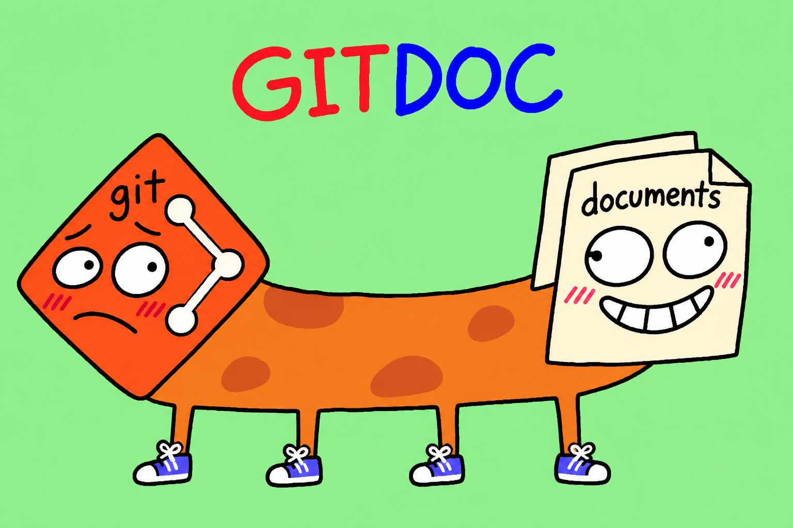

# GitDoc · Local document version control

English · [한국어](README.ko.md)



GitDoc opens Hangul, Word, PDF, PowerPoint, and Excel files inside a desktop window. Compare versions side by side, make supported edits, and review proposals or merge branches in a local version history. [Project brief and mockups (Korean)](기획서.md)

## GitDoc Hub

The [GitDoc Hub](hub/README.md) is a separate hosted workspace for shared text documents, repository invitations, review, version history, and MCP.

## Getting started

The macOS and Windows desktop window uses Rust and [eframe](https://github.com/emilk/egui/tree/main/crates/eframe). It starts the Python document engine as a child process and talks to it over standard input and output. The desktop app and MCP share the engine and SQLite repository.

### Download

Experimental packages are attached to each release on the [Releases page](../../releases). They include the Python engine and PDFium, so no Python or Rust installation is needed.

| System | File |
| --- | --- |
| macOS 13 or later, Apple Silicon | `GitDoc-<version>-macos-arm64.dmg` |
| Windows 10 or later, x64 | `GitDoc-<version>-windows-x64-setup.exe` |

The macOS package is for Apple Silicon.

- **macOS**: open the disk image, drag GitDoc to Applications, and launch it from there. Starting with v0.1.2, the public app and disk image use Developer ID signing, and the disk image carries Apple's notarization ticket.
- **Windows**: run the setup file. The installer is unsigned. If SmartScreen prompts, choose **More info ▸ Run anyway**. It installs for the current user without administrator rights and registers `gitdoc://` links. Uninstalling removes the app and the link handler.

Packaged apps keep the repository, preview cache, and logs in `~/Library/Application Support/GitDoc` on macOS and `%APPDATA%\GitDoc` on Windows. Uninstalling or replacing the app leaves this folder in place. `DOCVERS_DB` still selects a different repository file.

LibreOffice, Poppler, rhwp, and Tesseract are not bundled. Install the ones you need as described in [Version history and comparison](#version-history-and-comparison). A packaged app also looks for rhwp at `tools/rhwp/rhwp` (`rhwp.exe` on Windows) inside its data folder.

The bundled Python runs the CLI and MCP server against the same repository. On macOS use `/Applications/GitDoc.app/Contents/Resources/python/bin/python3` with `/Applications/GitDoc.app/Contents/Resources/app/docvers.py` or `mcp_server.py`. On Windows use `python\python.exe` and `app\docvers.py` or `app\mcp_server.py` in `%LOCALAPPDATA%\Programs\GitDoc`.

### Run from source

Install Python 3.12 and a current stable Rust toolchain with Cargo. On macOS 12 or later, install Xcode Command Line Tools. On Windows, use the MSVC Rust toolchain and the Visual Studio Build Tools C++ desktop development workload.

**macOS**

```sh
python3.12 -m venv .venv
.venv/bin/python -m pip install -r requirements.txt -r requirements-mcp.txt -r requirements-desktop.txt
.venv/bin/python docvers.py open
```

**Windows PowerShell**

```powershell
py -3.12 -m venv .venv
.\.venv\Scripts\python.exe -m pip install -r requirements.txt -r requirements-mcp.txt -r requirements-desktop.txt
.\.venv\Scripts\python.exe docvers.py open
```

`docvers.py open` builds the executable with Cargo on first launch. After updating the source, rebuild with `cargo build --locked --manifest-path desktop/native/Cargo.toml`. On macOS, run `./desktop/build.sh` to build `.build/GitDoc.app` for Finder.

The repository defaults to `data/documents.sqlite3`. Set `DOCVERS_DB` to use a different file and give the desktop app, CLI, and MCP the same value.

### Cutting a release

The [release workflow](.github/workflows/release.yml) builds both packages with `packaging/macos.sh` and `packaging/windows.ps1`, installs each one on a clean runner, and checks it with `packaging/smoke.py`. It runs on pull requests that touch the app or the packaging, on manual dispatch, and on version tags.

1. Set the new `version` in `desktop/native/Cargo.toml`, refresh `Cargo.lock` with `cargo update --manifest-path desktop/native/Cargo.toml --package gitdoc-desktop`, and merge the change. The packages take their version from this file.
2. Tag that commit `vX.Y.Z` and push the tag: `git tag v0.2.0 && git push origin v0.2.0`.
3. The workflow checks that the tag matches the version. After the installation tests, macOS Developer ID signing, notarization, stapling, and Gatekeeper assessment succeed, download both artifacts from the tag run and publish them together using the repository owner account.

The macOS signing and notarization steps run on version-tag pushes in the upstream repository. They use the Actions secrets `MACOS_CERTIFICATE_P12_BASE64`, `MACOS_CERTIFICATE_PASSWORD`, `APPLE_ID`, `APPLE_TEAM_ID`, and `APPLE_APP_SPECIFIC_PASSWORD`. Pull requests and manually dispatched builds use ad-hoc signing.

To build locally, run `sh packaging/macos.sh` on an Apple Silicon Mac or `./packaging/windows.ps1` in PowerShell 7 with Inno Setup 6 installed. Output goes to `dist/`. The local macOS bundle uses ad-hoc signing.

## Browser viewer

The desktop app and web viewer share the same document workspace. Check the workspace label and ID in both headers. Select **브라우저에서 보기** to open the current version or comparison in your default browser. To open it in Codex's built-in browser, paste the address from **웹 링크 복사**. Use **웹 문서함 링크 복사** to open the workspace library instead. Document links carry over the branch, versions, page or changed region, and spreadsheet position. Reload the browser to see changes saved from the desktop app or command-line tools. Compare a pending draft with the current branch head and choose **검토 및 확정** to approve it in the same workspace.

Use `python docvers.py open --browser` to open the local library. For Codex's built-in browser, use the MCP tool `open_browser_view` or add `--url` to start the local viewer and print its URL without opening the default browser.

```sh
python docvers.py open 1 --version 2 --page 3 --browser --url
python docvers.py open 1 --base 2 --target 3 --browser --url
```

The viewer listens on loopback, normally `127.0.0.1:8796`. Open its URL in a browser on the same computer. If the default port serves another workspace, GitDoc finds a separate port. Set `DOCVERS_PORT` to use a fixed port, or run `python app.py` in the foreground. A workspace link verifies the store before resolving the document ID.

## Version history and comparison

Use the browser's pinned toolbar to switch branches or inspect version history without losing your place. Use the desktop sidebar to submit a proposal.

In the browser, select text on a rendered page or click a spreadsheet cell, then select **수정 위치 복사**. Paste the JSON into an agent conversation. It contains the exact document and version, selected text and rendered page coordinates, or the sheet and source cell address. The included link reopens the location.

1. Register an original file to create `v1.0.0` on `main`. Open a document or pick a specific version to read it in the app. **Save original** exports the stored file. GitDoc stores the original bytes of supported files up to 30 MiB each by default. Set `DOCVERS_MAX_FILE_MIB` to an integer from 1 to 100 before starting the desktop app, CLI, or MCP server to change the upload limit.
2. Create branches or submit draft revisions. Review each proposed change, then approve or reject it. In **Compare two versions**, choose a different revision from the history to change the target while keeping the chosen base. Select **View one version** to leave comparison.
3. Compare branch heads and their common ancestor. To resolve a conflict, submit a merged file of the same format. Restoring an older version records a new version.
4. In the desktop app or browser, scroll through successive pages or use the page buttons to jump. The page number follows scrolling. The viewer prioritizes visible pages and pre-renders one page above and below them. Comparisons align pages by content and show each version’s original page number. Below the page controls, use **Previous change** and **Next change** to jump between visual changes. Nearby highlights are merged into at most seven boxes per page. If they cover at least 80% of the page, the viewer highlights the entire page as one change. The total appears after scanning finishes. GitDoc matches spreadsheets by sheet name, so a reordered sheet keeps its identity. You can open a specific sheet and cell address.

| Format | Preview and comparison |
| --- | --- |
| PDF | Render and compare pages side by side |
| HWP, HWPX | Convert to PDF with rhwp |
| DOC, DOCX, DOCM, ODT, PPT, PPTX, PPTM, ODP, ODS | Convert to PDF with LibreOffice |
| XLS, XLSX, XLSM | Compare cell values, merges, and some formatting by sheet and address. Print-layout preview is also available. |
| CSV, TSV | View and compare literal cell values. Compare by row number or by a shared unique header selected in the desktop app or passed as `--row-key`. |

The native app renders pages with PDFium and computes visual changes in its Rust worker. The Python bridge supplies cached PDF paths and document metadata. GitDoc reuses cached page fingerprints across the browser and desktop app. The browser uses PDFium for most previews and Poppler's `pdftoppm` for forms and font substitution. Both sides of a browser comparison use Poppler if either side requires it. LibreOffice's `soffice` can be found on PATH or in standard installation locations. For Hangul files, install the [rhwp](https://github.com/edwardkim/rhwp) executable on PATH or at `data/tools/rhwp/rhwp` (`rhwp.exe` on Windows). Use `DOCVERS_PDFTOPPM`, `DOCVERS_SOFFICE`, and `DOCVERS_RHWP` to supply explicit tool paths.

Drag across text on a rendered page, then press **Cmd+C** on macOS or **Ctrl+C** on Windows. You can select text on either side of a comparison. GitDoc uses embedded text where available and prepares OCR after displaying the page for scans and outlined text. The macOS app build includes an Apple Vision helper. For OCR without that helper, install Tesseract with Korean and English language data and put it on PATH or set `DOCVERS_TESSERACT`. `DOCVERS_OCR_LANGUAGES` sets the Tesseract languages and defaults to `kor+eng`. Recognized text can contain errors.

Inserted and deleted pages appear separately with a placeholder on the side where the page is absent. Pages with identical rendered content remain paired after a shift. Repeated footer-only differences are still highlighted and shown separately from the main change count. Hangul and Office layout depends on the converter and installed fonts. The spreadsheet view shows values and XLSX formulas, with differences in cell values, merged ranges, and some formatting. Use print-layout preview to review charts and printed pages. Original downloads are available for encrypted files or files that fail to render. GitDoc keeps DOCM, XLSM, and PPTM bytes intact and disables macro execution in the conversion profile. ODS uses page comparison. CSV uses commas and TSV uses tabs. Both accept UTF-8, BOM-marked UTF-16, and CP949. To compare reordered rows, choose a common header in the same column position with unique, nonblank values on both sides. The table view supports up to 25,000 fields per version. The original and PDF export remain available for larger tables.

## Fonts in document previews

GitDoc scans system and user font folders. Office previews use installed or embedded fonts when available and substitute missing families with installed alternatives. Hangul previews use system fonts and choose Korean fallbacks for missing serif and sans-serif families. Browser and desktop previews use Poppler for PDFs with unembedded fonts when it is available. The native PDFium renderer can also use system font folders. The stored file remains intact.

Use `python docvers.py fonts` to list installed families. To check a family or choose a replacement for a missing font, run:

```sh
python docvers.py fonts --resolve "Calibri"
python docvers.py fonts --set "Calibri" "Arial"
python docvers.py fonts --remove "Calibri"
```

Substitution rules are stored in `font-substitutions.json` beside the local database and apply to LibreOffice and Poppler previews. Reopen a preview to apply a changed rule. Set `DOCVERS_FONT_DIRS` to a platform-separated list of additional directories for discovery, rhwp, Fontconfig, and native PDFium. Set `DOCVERS_UI_FONT` to a local font file to prefer it for desktop UI text. Substitutions can affect glyph widths or line breaks.

## Automatic version labels

Each document starts at `v1.0.0`. GitDoc measures edits against the selected branch's base version and assigns document-wide labels in issuance order. Labels stay fixed after approval or rejection. Existing history receives display labels while keeping version IDs and original files.

| Edit size | Rule | Example |
| --- | --- | --- |
| Small | Up to 4 changed units | `v1.0.0` → `v1.0.1` |
| Medium | At least 5 changed units, below the large threshold | `v1.0.1` → `v1.1.0` |
| Large | At least 30 changed units and at least half the size of the larger version | `v1.1.0` → `v2.0.0` |

Spreadsheet units are cell values and extracted formulas keyed by sheet and address. Other formats use extracted words and punctuation. Files with identical or unavailable extracted text receive a small version increment. Use the comparison view to inspect visual differences, and MCP's `version_label`, `change_scale`, and `change_basis` to inspect the assigned label and how it was calculated.

## Editing in the app

In the desktop version history, right-click a commit to rewind the current branch to that version or to remove that commit and the newer commits from the branch. GitDoc asks for confirmation and creates a `recovery-…` branch at the old head. A regular restore instead records the old contents as a new version. The rewind is also available through `reset_document_branch`.

Open **텍스트 수정** from an approved version to change its text beside the preview. Saving opens the comparison with the previous version. If the head changes while editing, start again from the latest version.

Enable **설정 → 수정안 검토 사용** in the desktop app to save new desktop edits and submissions as pending drafts. A yellow background in the version history identifies pending drafts, which can be approved or rejected. Review is off by default, so new desktop versions are approved immediately. Existing pending drafts keep their status. MCP and CLI draft tools continue to create pending revisions.

[PPTX design](assets/editor-designs/pptx.png) · [DOC design](assets/editor-designs/doc.png) · [HWP design](assets/editor-designs/hwp.png)

PPTX opens with slide navigation and slide and object tools. DOC and DOCX open with page navigation, a ruler in centimeters, and text formatting tools. HWP and HWPX open with a list of editable paragraphs on the current page. Page and zoom controls stay along the bottom. The current page's thumbnail uses the existing render.

| Format | In-app edits |
| --- | --- |
| HWP, HWPX | Type in body paragraphs, insert tables and shapes, or find and replace text in the body and tables |
| DOC, DOCX | Type in body paragraphs, apply basic formatting, and insert tables and shapes. DOCX also offers a text-block editor. |
| PPTX | Type directly on slides and in table cells, format text, and edit slides and objects |
| XLSX | Double-click a cell on the current version to edit its value or formula, or clear the value. Excel recalculates formulas based on workbook settings. |
| PDF | Rotate or delete a page, add a note annotation, or insert a blank page or pages from another PDF. |
| PPT, XLS, ODT, ODS, ODP, DOCM, XLSM, PPTM, CSV, TSV | Submit a revised file from an external editor |

Open **슬라이드 편집** from the current approved PPTX version and click text or a table cell on the canvas. Use the keyboard to type, select, copy, paste, undo, and redo. The toolbar includes font, size, bold, italic, underline, color, alignment, lists, indentation, and spacing. It also adds, duplicates, and deletes slides and inserts text boxes, images, shapes, and tables. Shift-click objects to group them. The editor writes changes with [python-pptx](https://github.com/scanny/python-pptx). Text embedded in an image requires editing or replacing the image.

Save with **수정안 저장**, **Cmd+S** on macOS, or **Ctrl+S** on Windows. The change reason is optional. Press **Enter** in the reason field to save. Changing text-box alignment redraws only that box on the editing canvas. When the slide order stays the same at save time, GitDoc renders the changed slides and reuses the verified unchanged pages for the comparison preview.

Open **본문 편집** in DOC, DOCX, HWP, or HWPX. Use **표** to select 1–12 rows and columns, or **도형** to insert a rectangle, ellipse, triangle, or right arrow. GitDoc uses the selected body paragraph, or a body paragraph on the current page. In Hangul, a new shape occupies its own paragraph after the anchor. Use **수정안 저장** to save a new version in the original format, then review the comparison. Some multipage layouts have no verifiable insertion point on the current page.

In HWP and HWPX, click a table or select it from **기존 표**. GitDoc outlines the selection. In DOC and DOCX, use **문서 표** to select a top-level body table by its order, dimensions, and text. **표 전체 삭제** removes the selected table and its contents. Undo is available before saving.

For existing standalone inline shapes, open **도형 선택** under **도형 서식** in Word documents or **도형 도구** in Hangul documents. Pick the shape by paragraph and size. Move it one paragraph up or down where available, enter its width and height in millimeters, or delete it. Undo is available before saving. Floating and grouped shapes require additional support. Rotation and resizing rotated shapes are outside these controls.

In Hangul documents, **편집**, **서식**, and **입력** give access to clipboard tools, existing object insertion, and paragraph formatting. Select a supported body paragraph and use **서식** for font, size, bold, italic, underline, color, alignment, and line spacing. Formatting applies to the whole paragraph.

For HWP and HWPX, click a supported table cell on the page or choose **기존 표** and the cell coordinates under **표 레이아웃**. Use **셀 내용 편집** and **셀에 적용** to replace or clear a single line of text. Undo remains available until **수정안 저장** creates a new version in the original format. The current cell editor supports unmerged, unprotected cells with one plain text run, including empty cells.

DOC uses LibreOffice to convert to DOCX for editing and back to DOC when saving. HWP and HWPX use rhwp with table and shape insertion support. HWP triangles and right arrows use editable, closed HWPX polygons that rhwp saves back to HWP. Legacy format conversions can change existing layout or formatting. For direct text entry, the canvas uses the font, size, and color from the preview. Unavailable fonts follow the document font substitution rules.

The desktop app, MCP, and CLI use the same Rust PDF editor, powered by [lopdf](https://github.com/J-F-Liu/lopdf). The macOS app bundle includes the editor, and the standard Cargo build creates it alongside the Windows app. Password-protected and signed originals cannot be edited.

To insert pages, enter the page number they should go before. Enter the current page count plus one to append. GitDoc records the insertion position and page count in the version history. When comparing versions, **GitDoc 편집 기록** takes priority through recorded PDF edits. **자동 판정** identifies inferred insertions from uploaded versions where no applicable record exists.

[office_oxide](https://github.com/yfedoseev/office_oxide) handles compatible Word and PowerPoint find-and-replace edits. GitDoc edits the document XML directly for individual text blocks, formatting, and spreadsheet cells. Save several text block changes together as one draft, then review the rendered comparison. The equivalent MCP workflow is `list_editable_blocks` followed by `edit_revision` with `operation: edit_blocks`.

## Exporting versions

Open **Save** to export the selected version. Every supported format can be saved as PDF. Extra choices depend on the source format.

| Source | Additional editable exports |
| --- | --- |
| HWP or HWPX | The other Hangul format |
| DOC | DOCX and ODT |
| DOCX | ODT and DOC |
| ODT, ODS, ODP | DOCX, XLSX, and PPTX, respectively |
| PPT or PPTX | The other PowerPoint format and ODP |
| XLS or XLSX | The other Excel format and ODS |

PDF export uses the app's print layout. ODT, ODP, and ODS exports can be opened in a compatible editor. On macOS and Windows, **Print** opens the system dialog for the selected version so you can choose a printer and page range. In a comparison, **Save** and **Print** act on the target version.

## Local working copies

Replace `/path/to/gitdoc` with this checkout's absolute path.

```sh
alias docvers='/path/to/gitdoc/.venv/bin/python /path/to/gitdoc/docvers.py'
docvers list
docvers checkout 1
docvers branch budget-review
docvers checkout 1 -b budget-review
docvers status
docvers diff
docvers commit -m 'Update budget details'
```

Edit checked-out originals in your usual editor. Branch switching protects uncommitted changes. Use review or merge to apply changes to `main`.

## MCP and the desktop skill

```sh
codex mcp add gitdoc -- "$PWD/.venv/bin/python" "$PWD/mcp_server.py"
```

On Windows, use the absolute paths to `.venv\Scripts\python.exe` and `mcp_server.py`. In a new Codex session, use `search_documents`, `list_branches`, `list_versions`, `read_version`, `compare_versions`, and `compare_branches` to inspect the repository. Use `register_document`, `create_document_branch`, `submit_revision`, `edit_revision`, `review_draft`, `merge_document_branches`, and `restore_document_version` to work with it. Upload tools accept an absolute local path to a user-selected file. For approving, merging, or restoring, use the applicable branch head IDs from the latest lookup.

For CSV and TSV, pass the header name as `row_key` to `compare_versions` to align reordered rows. The generated desktop links open the same alignment.

| Task | MCP tool |
| --- | --- |
| List supported edits and export formats | `get_document_capabilities` |
| Find physical pages and aligned comparison positions | `get_preview_info` |
| View a page or a side-by-side diff as a PNG attachment | `render_document_page` |
| Find numbered visual changes and footer-only changes | `list_visual_changes` |
| Read PDF notes or inspect and compare cells, formulas, styles, and merges | `get_pdf_notes`, `inspect_workbook` |
| Save the original, PDF, or a compatible format | `export_document` |

The MCP image is returned as `image/png`. For side-by-side images, pass the target as `version_id`, the baseline as `base_version_id`, and the aligned position as `page`. Use `change` to outline a numbered change. Follow `next_offset` to continue listing positions or changes. For exports, supply an absolute local path. Set `overwrite` explicitly to replace an existing file.

Every MCP tool can also run directly through the CLI. Run `docvers tool` to list tools and argument schemas. Use `--json -` to read a JSON object from standard input or `--output -` to stream an image as PNG.

```sh
docvers tool render_document_page --json '{"document_id":1,"version_id":2,"page":1}' --output preview.png
docvers tool export_document --json '{"document_id":1,"version_id":2,"output_path":"/absolute/path/export.pdf"}'
docvers print 1 2
```

CLI printing uses CUPS `lp` on macOS and Linux or the registered PDF print handler and default printer on Windows. Use `export_document` to prepare a print-layout PDF without sending a print job.

The [desktop skill](.agents/skills/document-versions-desktop/SKILL.md) describes how to open comparisons. These commands use example document and version IDs. The window shows the version labels, such as `v1.0.1`.

```sh
.venv/bin/python docvers.py open 1 --version 2 --page 2
.venv/bin/python docvers.py open 1 --base 2 --target 5 --page 2 --change 1
.venv/bin/python docvers.py open 1 --base 2 --target 5 --sheet '산출 내역' --cell B4
```

## License

GitDoc is available under the [MIT License](LICENSE). [rhwp](https://github.com/edwardkim/rhwp) is MIT-licensed, [office_oxide](https://github.com/yfedoseev/office_oxide) is dual-licensed under MIT or Apache-2.0, and [lxml](https://github.com/lxml/lxml/blob/master/LICENSES.txt) and [pypdf](https://github.com/py-pdf/pypdf/blob/main/LICENSE) use BSD-family licenses. External tools and libraries retain their own licenses and notices.
