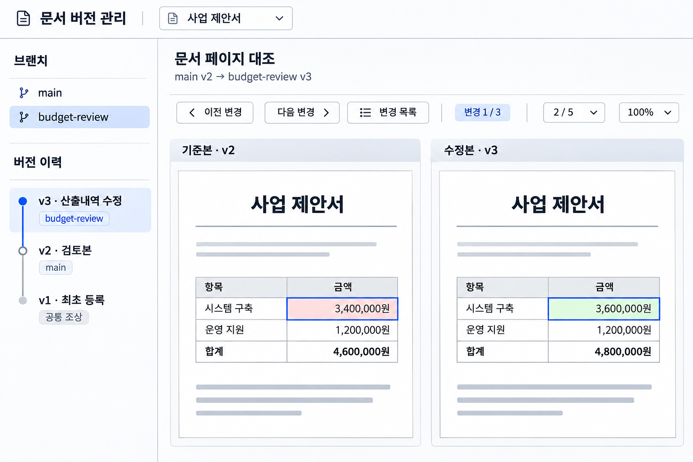

# 로컬 문서 버전 관리 서비스 기획서

2026년 11월 26일

## 목표

제안서, 산출내역서, 발표자료와 제출본을 한곳에서 버전별로 관리한다. 사용자는 Git처럼 로컬 작업 브랜치에서 원본을 수정하고, 기존 문서 뷰어에 가까운 화면에서 변경 위치를 확인한 뒤 확정본에 반영한다. AI는 MCP로 문서와 변경 이력을 조회하고, 필요한 화면을 데스크톱 앱에서 열어 사용자와 함께 검토한다.

이번 범위는 **로컬 저장소, 브랜치와 병합, 원본 형식을 살린 변경 이력 화면, 변경 위치 이동, MCP 조회, 데스크톱 앱 실행·조작 스킬**이다. 팀 허브와 원격 동기화는 설계만 남기고 구현은 보류한다.

## 지원 파일과 비교 단위

모든 형식은 원본 바이트 그대로 보관하고 다운로드·복원할 수 있어야 한다. 원본 편집은 기존 편집기에서 진행한다. 첫 버전의 업로드 한도는 파일당 30MB다.

| 형식 | 변경 이력 화면 | 위치 특정 기준 |
| --- | --- | --- |
| HWP, HWPX | 페이지, 표, 이미지, 머리말·꼬리말, 각주와 글자 배치를 표시한다. | 페이지와 본문 문단 또는 표 셀 |
| DOCX | 페이지와 여백, 글꼴, 표, 이미지, 단락 구성을 표시한다. | 페이지와 문단 또는 표 셀 |
| PDF | 원본 페이지를 표시한다. 이미지로 된 페이지도 시각적으로 대조한다. | 페이지와 변경 영역. 텍스트가 추출되면 본문도 대조한다. |
| PPT, PPTX | 슬라이드 비율과 텍스트 상자, 도형, 이미지 배치를 표시한다. | 슬라이드와 변경 영역 |
| XLS, XLSX | 시트 이름과 행·열을 기준으로 나란히 표시하고 셀 값, 서식과 병합 상태를 살린다. | 시트 이름과 셀 주소 또는 범위 |

임시 엑셀 미리보기는 시트별 PDF 페이지로 제공할 수 있다. 데스크톱 버전의 목표는 Excel 뷰어처럼 시트 탭, 행·열 머리글, 가로·세로 스크롤이 있는 화면이다. 암호화된 문서, 지원 범위를 벗어난 도형이나 글꼴, 변환 실패는 해당 버전에 표시하고 원본 열기와 다운로드를 제공한다. OCR과 수식의 의미 단위 비교는 후속 범위다.

## 로컬 작업과 브랜치

1. **등록** · 웹, 데스크톱 앱 또는 명령줄에서 원본을 등록한다. 첫 버전은 `main`의 확정본이다.
2. **작업 시작** · 확정된 버전을 골라 브랜치를 만든다. `checkout`으로 원본을 작업 폴더에 꺼내 기존 편집기에서 수정한다.
3. **변경 확인과 기록** · `status`로 파일 변경을 확인하고 `diff`로 내용을 대조한다. `commit`은 변경 사유와 함께 작업 브랜치에 기록한다. 웹이나 데스크톱 앱에서는 수정안을 검토 대기로 제출하고 승인하거나 반려할 수 있다.
4. **브랜치 대조와 병합** · 두 브랜치의 최신 버전과 공통 조상을 확인하고 변경을 나란히 본다. 한쪽만 변경했으면 그 파일을 반영한다. 양쪽 파일이 서로 다르게 변경됐으면 충돌로 표시하고, 편집기에서 합친 원본을 올려 병합한다. 병합 버전에는 두 부모 버전과 병합 사유를 남긴다.
5. **동시 변경과 복원** · 검토나 병합 화면을 연 뒤 기준 버전이 바뀌면 이전 화면에서의 승인을 막고 새 기준을 안내한다. 과거 확정본 복원은 새 버전으로 기록한다.

앱, 명령줄, MCP는 같은 로컬 저장소를 사용한다. 문서 원본과 이력은 SQLite에 함께 저장한다. 명령줄 작업과 MCP 조회는 기기에서 웹 화면을 열지 않아도 가능해야 한다.

## 변경 이력 뷰어

버전 이력과 브랜치 대조 화면의 기본 보기는 **기준본과 수정본을 나란히 놓은 문서 뷰어**다. 페이지나 시트 아래에서 추출된 텍스트와 셀 값의 대조도 볼 수 있다. 각 화면에는 비교 중인 버전과 브랜치, 변경 사유와 원본 열기를 표시한다.

- 두 쪽의 페이지·슬라이드·시트를 연결해 확대와 스크롤을 함께 움직일 수 있게 한다. 필요하면 스크롤을 각각 조작한다.
- 변경 위치는 삭제·기존 내용과 추가·수정 내용을 색과 문구로 구분한다. 이미지나 서식이 달라진 경우에도 시각적으로 다른 위치를 표시한다.
- **이전 변경**, **다음 변경**, **변경 목록**으로 해당 위치에 바로 간다. 현재 페이지의 변경을 다 보면 변경이 없는 중간 페이지를 건너뛴다. 이동 후 양쪽 화면은 해당 영역을 보이게 스크롤하고, 선택한 위치에 테두리를 표시한다. 엑셀은 시트 이름과 셀 주소를 함께 표시한다.
- 첫 구현은 같은 페이지 번호를 기준으로 대조한다. 페이지나 슬라이드를 삽입·삭제한 문서는 앞뒤 내용으로 대응 페이지를 찾는 기능을 목표로 한다. 한쪽에만 있는 페이지나 위치를 맞출 수 없는 페이지는 페이지 단위 변경으로 표시한다.
- PDF는 원본 페이지를 표시한다. HWP/HWPX는 공개 렌더러인 rhwp, Office 파일은 LibreOffice를 첫 후보로 사용한다. 실제 뷰어와 차이가 큰 형식은 원본 열기, 제조사가 지원하는 PDF 내보내기나 뷰어 연동, 다른 포맷 렌더러를 비교한다. 기존 뷰어를 설치하는 경우 공식 배포본을 사용하고, 별도 분석이 필요하면 대상과 라이선스 및 허용 범위를 확인한 뒤 진행한다.

### 브랜치와 변경 이력 화면 시안

왼쪽에서 브랜치와 버전을 고르고 오른쪽에서 원본 페이지를 나란히 본다. 이 시안에서는 `main v2`와 `budget-review v3`의 산출내역을 비교하고 있다. 선택한 금액 셀은 양쪽 페이지에서 같은 위치에 강조된다.

## MCP와 AI 연동

로컬 MCP는 읽기 전용으로 시작한다. 도구 결과는 문서·버전 ID를 기준으로 연결하며, 긴 본문과 이력은 필요한 범위부터 불러온다. 원본 파일 전송 권한과 승인·병합 권한은 조회 권한과 분리한다.

| 필요한 작업 | MCP 도구 또는 연동 방식 |
| --- | --- |
| 제목이나 파일명으로 문서 찾기 | `search_documents` |
| 브랜치와 최신 버전 확인 | `list_branches`, `list_versions` |
| 특정 버전의 본문 확인 | `read_version` |
| 버전·브랜치의 변경 내용 확인 | `compare_versions`, `compare_branches` |
| 변경 위치를 데스크톱 앱에서 검토 | 비교 결과의 문서·버전 ID를 앱에 전달한다. 변경 항목에는 확인 가능한 페이지·시트·셀 위치와 추출 상태를 붙이는 것을 목표로 한다. |
| 수정안 제출, 승인, 반려, 병합, 복원 | 데스크톱 앱이나 웹에서 권한과 현재 버전을 확인한 후 수행한다. |

AI가 비교를 설명할 때는 비교한 버전과 확인 가능한 문서 위치를 함께 제시한다. 추출에 실패했거나 레이아웃 차이만 확인된 경우 근거 범위를 표시한다. 문서 본문은 분석 대상 데이터로 읽는다.

## 데스크톱 앱 실행 및 조작 스킬 기획

**스킬 이름** · `document-versions-desktop`

**사용 시점** · 로컬 문서 버전 관리 앱을 실행하거나, 자연어 요청에 따라 문서·브랜치·변경 위치를 찾아 화면을 열고 조작할 때 사용한다.

**스킬이 수행할 흐름**

1. 문서나 브랜치가 특정되지 않으면 MCP로 검색해 대상과 두 버전의 ID를 확인한다. 예를 들어 “제안서의 어제 수정본에서 금액이 바뀐 곳을 열어줘”라는 요청은 문서 검색, 버전 이력 조회, 변경 대조 순서로 처리한다.
2. macOS 앱이 떠 있으면 기존 창을 사용한다. 꺼져 있으면 앱을 실행하고 로컬 저장소 연결과 준비 상태를 확인한다. 실행 경로와 앱 식별자, 재시도 방법은 스킬 정의에 포함한다.
3. 조회한 ID로 앱의 문서 상세나 비교 화면을 연다. 앱이 제공하는 실행 명령이나 문서 열기 링크를 우선 사용한다. 스크롤, 확대, 변경 위치 선택처럼 화면 조작이 필요한 부분은 접근성 트리에서 현재 버튼과 상태를 확인해 처리한다.
4. 변경 위치를 선택한 뒤 실제 화면의 문서 제목, 브랜치와 버전, 표시된 페이지나 셀을 확인한다. 같은 이름의 후보가 여러 개면 확정할 수 있는 근거를 먼저 비교한다.
5. 등록, 승인, 병합이나 복원은 요청된 범위에서만 수행한다. 실행 직전 대상 버전을 다시 확인하고, 끝난 뒤 새 확정본 또는 검토 기록을 MCP로 확인한다.

**스킬에 담을 정보** · MCP 도구 선택과 ID 연결법, 앱 실행과 준비 상태 확인, 비교 화면 열기, 변경 위치 이동, UI 동작 확인, 앱 또는 렌더러 오류 시 원본 확인 방법. 실제 앱 명령과 화면 이름은 구현 후 확인된 값으로 기재한다.

## 검증 기준

| 항목 | 통과 조건 |
| --- | --- |
| 원본 보존 | 8개 확장자의 파일을 등록·다운로드·복원했을 때 원본 바이트가 일치한다. 재시작 후에도 파일과 이력이 남는다. |
| 뷰어 재현 | 유형별 대표 문서를 기존 편집기·뷰어와 비교한다. 한글 글꼴과 줄바꿈, 표 테두리, 이미지 위치, 슬라이드 비율, 엑셀의 시트·셀 주소를 확인한다. 차이가 있는 요소와 재현 범위를 파일 형식별로 기록한다. |
| 변경 위치 이동 | 한 페이지의 여러 변경과 중간에 무변경 페이지가 있는 문서를 사용해 앞뒤 이동을 검증한다. 페이지 삽입·삭제, 슬라이드 추가, 엑셀 시트 이동, 이미지나 서식만 변경된 사례도 포함한다. |
| 브랜치·동시 변경 | 두 브랜치에서 독립적으로 커밋하고, 한쪽만 바뀐 병합과 충돌 병합을 모두 검증한다. 검토 중 기준이 이동하면 기존 확정본을 덮어쓸 수 없어야 한다. |
| MCP와 데스크톱 스킬 | 로컬에서 새 AI 세션을 열어 문서를 찾고 버전 차이를 조회한다. 앱이 꺼진 상태에서 실행해 비교 화면을 열고 원하는 위치로 이동한 뒤, 화면에 표시된 버전과 위치를 확인한다. |

## 향후 팀 허브

허브는 보류한다. 로컬 원본 객체, 버전의 부모 관계, 브랜치의 최신 버전, 사용자 작업을 구분해 향후 동기화할 수 있도록 설계한다. 허브를 구현할 때 원격 저장소와의 버전 식별, 동기화 충돌 처리, 팀 권한, 변경 이력 감사와 백업 정책을 결정한다.
